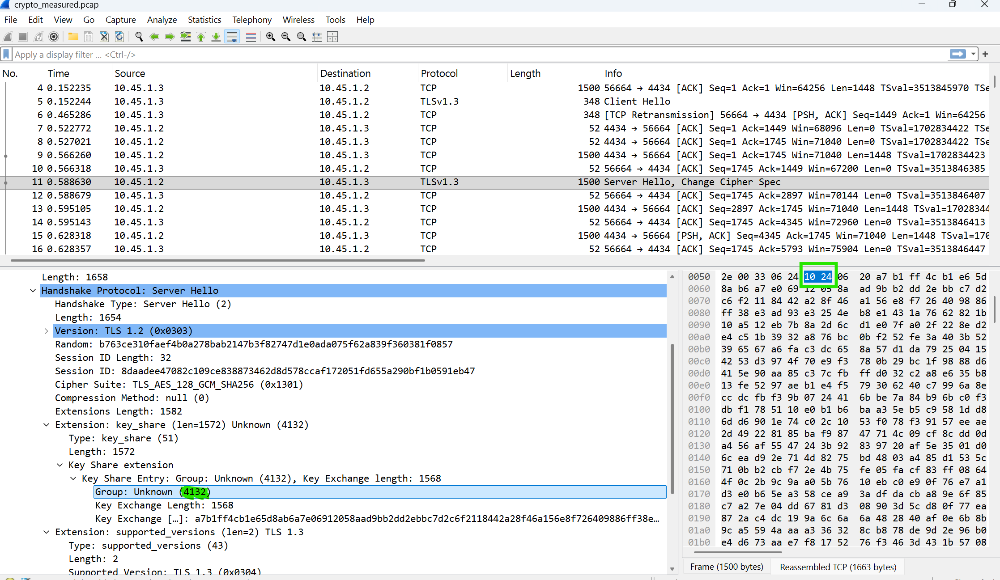

# ERA-Crypto: Policy-Bounded Post-Quantum Crypto-Agility for a 5G/O-RAN Testbed

**Reproducible implementation · Experimental configuration · Packet traces · Analysis and validation**

ERA-Crypto is a context-aware post-quantum cryptography (PQC) selection framework implemented over a software-defined 5G/O-RAN environment. The system selects a TLS 1.3 key-encapsulation mechanism (KEM) using dual-gNB E2/KPM-derived path activity and selects a TLS signature configuration using endpoint battery state. Every selection remains subject to a configured, PQC-only policy envelope.

This repository organizes the deployment scripts, controller and endpoint components, experimental settings, processed measurements, validation records, and selected packet captures needed to examine the implementation and reproduce its available results. It supports two workflows:

- **Offline verification:** reproduce measurements from the included TLS PCAP samples and examine the processed dataset without running a 5G stack.
- **End-to-end execution:** reconstruct the four-machine environment, validate the radio/core/RIC/TLS stack, and run a new blocked campaign with the same recorded design.

> **Artifact scope:** The processed dataset covers **200 accepted runs**. This repository includes **representative raw PCAP samples**, not necessarily the complete set of raw captures for all runs. An independent deployment also requires compatible, locally built software and appropriately sanitized configuration templates. Check the [release inventory](#repository-layout) and [reproducibility status](#reproducibility-status) before treating the checkout as a turnkey installation.

## 1. Architecture

```text
                         Alienware x16 R2 (Ubuntu / VMware)
         ┌─────────────────────────────────────────────────────────┐
         │ VM1 (gNB1 + Open5GS + near-RT RIC + ERA controller)     │
         │                              │                          │
         │                 dual-gNB E2/KPM observations            │
         │                              │                          │
         │ VM2 (gNB2) ──────────────────┘                          │
         └─────────────────────────────────────────────────────────┘
                           5G user-plane path
  ┌──────────────┐        ┌─────────┐       ┌─────────┐     ┌───────────────┐
  │ UE2: Pi 5    │ ─ZMQ─► │  gNB1   │ ─core─►│  gNB2   │─ZMQ─►│ UE1: Pi 5     │
  │ srsUE        │        └─────────┘       └─────────┘     │ srsUE         │
  │ PQC client   │◄──────────── PQC decision ────────────────│ PQC server    │
  │ ERA agent    │                                          └───────────────┘
  └──────────────┘
         │
         └── controlled endpoint battery state ─► ERA decision controller
```

**Data path.** UE2 (`10.45.1.3`) establishes PQC-enabled TLS connections to UE1 (`10.45.1.2`) through gNB1, Open5GS and gNB2. The gNBs and endpoints use software radio processing with **ZeroMQ-emulated baseband links**; there is no over-the-air RF link in this configuration. The 5G core, UE/gNB stacks, TCP/TLS traffic and E2/KPM collection execute as software services.

**Control path.** A controller uses a configured path-activity signal calculated from two gNB KPM streams and a controlled UE2 battery-state input. UE2's agent retrieves the resulting KEM/signature decision and the TLS client requests that pair. Policy validation and per-connection requested-versus-negotiated checks provide implementation evidence; they are not a substitute for an adversarial telemetry-security assessment.

### 1.1 Components and responsibilities

| Component | Location | Responsibility |
|---|---|---|
| `decision.py`, policy envelope, mode helper | VM1 | Select and enforce allowed KEM/signature combinations |
| Dual-gNB E2/KPM monitor and feed | VM1 / RIC, both gNBs | Supply path-activity observations to controller |
| `era7h_driver.py`, gates, validator, analysis | VM1 | Schedule randomized runs, collect artifacts and validate outcomes |
| OCUDU gNB1 + Open5GS core | VM1 | First radio access leg and 5G user-plane/core routing |
| OCUDU gNB2 | VM2 | Second radio access leg |
| PQC-TLS servers | UE1 | Server endpoints for Falcon-512 and ML-DSA-44 configurations |
| `agent.sh`, battery provider, benchmark worker | UE2 | Obtain decisions, generate TLS connections and collect captures |

### 1.2 Cryptographic decision policy

The evaluated selections are drawn from:

- **KEM:** ML-KEM-768 or ML-KEM-1024.
- **TLS signature configuration:** Falcon-512 or ML-DSA-44.
- **RAN input:** *path-active* versus *path-inactive*, based on an E2/KPM-derived threshold; this is **not** a direct congestion classifier.
- **Battery input:** controlled UE2 state of 90% or 15%; the configured threshold is 30%. This does **not** establish measured battery-life savings.

| Controlled context | UE2 battery | Path activity | Dual-axis selected pair |
|---|---:|---|---|
| `C00` | 90% | Inactive | ML-KEM-1024 + ML-DSA-44 |
| `CB0` | 15% | Inactive | ML-KEM-1024 + Falcon-512 |
| `C0F` | 90% | Active | ML-KEM-768 + ML-DSA-44 |
| `CBF` | 15% | Active | ML-KEM-768 + Falcon-512 |

The path-activity cutoff was configured as **322.4 kbit/s** in the processed KPM signal, and the active-path experiments used an iperf3 UDP offered rate of **0.712 Mbit/s**. The mapping and cutoffs are configured experimental policy choices, not independently optimized responses to congestion. The controller forbids classical-algorithm selection within the specified envelope; that statement does not by itself prove resilience to attacker-controlled telemetry.

## 2. Hardware and network configuration

The following inventory was inspected on **November 17, 2026**. It is a record of the observed machines; the *original run-time* software fingerprints are preserved separately in the campaign metadata.

| Machine | Hardware / virtual allocation | Memory | Role |
|---|---|---|---|
| Alienware host | Alienware x16 R2; Intel Core Ultra 9 185H (16 physical cores, 22 logical CPUs reported by Linux); NVIDIA RTX 4070 Laptop GPU (8,188 MiB VRAM) | ~30 GiB usable host RAM | VMware host |
| VM1 | VMware guest; 8 vCPUs, 8 cores/socket | 16 GiB configured (~15 GiB reported by guest) | gNB1, Open5GS, RIC, controller, experiment driver |
| VM2 | VMware guest; 8 vCPUs, 8 cores/socket | 16 GiB configured (~15 GiB reported by guest) | gNB2 |
| UE1 | Raspberry Pi 5 Model B Rev 1.1; 4 × Arm Cortex-A76 cores | 8-GB class (~7.8 GiB reported) | srsUE and PQC-TLS server |
| UE2 | Raspberry Pi 5, 4 × Arm Cortex-A76 cores (reported same hardware class as UE1) | 8-GB class (reported; independent system dump pending) | srsUE, PQC-TLS client, agent, worker |

Host storage: Samsung PM9F1 1024-GB NVMe (953.9 GiB displayed by Linux). The GPU is listed for system provenance; GPU acceleration for the radio/TLS experiment was **not established**. The two guests each have a 16-GiB allocation; these are configured allocations rather than measurements of simultaneous physical memory usage.

| Node | Historical management address | Experiment interface / relevant ports |
|---|---|---|
| VM1 | `192.168.0.4` | gNB1, controller API on port `8080` |
| VM2 | `192.168.0.5` | gNB2; route toward core through VM1 |
| UE1 | `192.168.0.10` | `10.45.1.2` in UE namespace; PQC server TCP ports `4433` and `4434` |
| UE2 | `192.168.0.20` | `10.45.1.3` in UE namespace; adaptive PQC-TLS client |

These management addresses are **lab-specific examples**. Adapt the network and UE namespace settings for another deployment. The archived VM2 route was `10.53.1.0/24 via 192.168.0.4 dev ens37`; confirm interfaces and subnet routing before applying it.

Both checked gNB YAML files specify **NR band 3, 10 MHz channel bandwidth, 15 kHz subcarrier spacing, 11.52 Msamples/s base sample rate and E2AP enabled**. These were observed in the November 2026 configurations; verify against archived hashes before treating them as unchanged historical files.

## 3. Software environment and provenance

### 3.1 Versions observed in the inspected environment

| Component | Version / identifier | Where observed |
|---|---|---|
| Host OS / kernel | Ubuntu 24.04.4 LTS / `7.0.0-28-generic` | Alienware, Nov. 17 |
| VMware Workstation | 26.0.0, build `25388281` | Alienware, Nov. 17 |
| VM1 and VM2 OS / kernel | Ubuntu 24.04 LTS / `7.0.0-38-generic` | Both guests, Nov. 17 |
| UE1 OS / kernel | Ubuntu 24.04.4 LTS / `6.8.0-1065-raspi` | UE1, Nov. 17 |
| Python | 3.12.3 | VM1, VM2, UE1 |
| GNU Radio | 3.10.9.2 | VM1 |
| Docker / Docker Compose | 29.1.3 / 2.40.3 | VM1 |
| TShark (Wireshark CLI) | 4.2.2 | VM1 |
| tcpdump / libpcap | 4.99.4 / 1.10.4 | VM1, UE1 |
| iperf3 | 3.16 | VM1, VM2, UE1 |
| OCUDU checkout | `c446f5d6ab2fe936ab6d75d04a5f4b12cb692bf7` | VM1 and VM2 |
| gNB executable SHA-256 | `e372a116dd0ad5149d8154ce3ebdbf94b4c677263d126a7145534f8bbb39f9b2` | VM1 and VM2, matching binaries |
| BoringSSL checkout | `0599bb559d3be76a98f0940d494411b6a8e0b18e` | UE1 |
| UE1 BoringSSL `bssl` SHA-256 | `5ae69072636050f8bcdc94cbc5f1efbc10e2775da59e28d1671ed1ce132556b6` | UE1, Nov. 17 |
| liboqs checkout | `d0d0413dc9fff538296ab86bac492cb4bf54dedb` | UE1 |
| srsRAN_4G checkout | `6bcbd9e5bf8686aa7085202cd847c5ddd64a9c16` | UE1 |

**Versioning caveats.** The UE1 BoringSSL and liboqs working trees contained extensive local modifications when inspected. A Git commit alone does **not** identify the exact executed binary. The UE2 revision and binary hash also require independent confirmation. Open5GS and RIC container image digests were not independently established from the November inspection (the VM1 container list was empty at that moment); consult the original campaign's saved `env_info.json` and preserved image/build metadata.

For a concise inventory and build-provenance checklist, see [Environment and builds](docs/ENVIRONMENT_AND_BUILDS.md). The dataset's `meta/env_frozen.json` records the code/binary hashes captured with the run; `meta/env_info.json` contains original software/environment observations. Use these files as the primary provenance records and compare them to the current working trees **before claiming a bit-for-bit reproduction**. If relevant local source modifications are required, preserve and review patches separately from build outputs, credentials and generated files.

### 3.2 Rebuilding the original crypto environment

A matching PQC stack requires compatible BoringSSL/liboqs source and local changes, the correct enabled algorithms, and server/client build settings. Record:

```bash
# Run on EACH endpoint and retain the output in a private environment inventory.
git -C ~/Downloads/boringssl rev-parse HEAD
git -C ~/Downloads/boringssl status --short
sha256sum ~/Downloads/boringssl/build/tool/bssl

git -C ~/Downloads/liboqs rev-parse HEAD
git -C ~/Downloads/liboqs status --short
git -C ~/srsRAN_4G rev-parse HEAD
```

When reconstructing from a fresh checkout, apply reviewed relevant patches, compile compatible binaries and confirm their supported groups and signature configuration. Do **not** distribute endpoint private keys or original subscriber credentials. Where complete patches/build instructions have not been released, the full implementation is **not yet independently build-reproducible**.

## 4. Repository layout

```text
Era-Crypto_Files/
├── README.md
├── code/
│   ├── vm1/                       # Controller, E2/KPM, experiment orchestration
│   │   ├── runtime/               # Installed era7h scripts (if collected)
│   │   └── ...
│   ├── vm2/                       # Second gNB helper scripts (if available)
│   ├── ue1/                       # PQC-TLS server helpers
│   └── ue2/                       # Agent, battery and benchmark worker
├── configs/                       # Reviewed configuration templates only
├── analysis/
│   ├── reanalyze_samples.sh       # Offline sample-PCAP analysis
│   └── ...
├── data/
│   ├── processed/                # Run/cell summaries and paired statistics
│   ├── primary_pairing_manifest.csv  # Optional run-level pairing audit
│   ├── table_primary_comparisons.csv # Optional curated summary
│   └── pcap_samples/
│       └── <RUN_ID>/
│           ├── VALID.ok
│           ├── COMPLETE.ok
│           ├── metadata.json
│           ├── validation.json
│           ├── pcap_summary.json
│           ├── pcap_stream_metrics.csv
│           └── ue2/
│               ├── crypto_measured.pcap
│               └── crypto_log_measured.csv
├── integrity/
│   ├── campaign_config.json       # Actual run settings (when included)
│   ├── schedule.csv               # Randomized schedule
│   ├── sample_manifest.tsv        # Which samples were actually included
│   └── ...
└── docs/
    ├── images/wireshark_mlkem1024_serverhello.png
    └── ...
```

The private source archive may also contain the complete original accepted-run tree, failed/quarantined attempts, raw telemetry and private machine-specific settings. **These are not implicitly part of a public checkout.** Consult `integrity/sample_manifest.tsv` for the actual list of released PCAPs rather than assuming every example listed below was transferred.

## 5. Reproduce the included packet measurements (no 5G hardware required)

The packet-level workflow uses the original PCAP analyzer and pairs each capture with its measured-connection CSV. Its output includes TCP-frame bytes and packet counts by stream, TCP SYN/SYN-ACK RTT estimates, retransmission counts and flow duration. **Captured frame bytes are not the same metric as TLS application payload bytes or KEM operation time.**

### Step 1 — Clone and install dependencies

```bash
git clone https://github.com/SanzidaH/Era-Crypto_Files.git
cd Era-Crypto_Files

sudo apt-get update
sudo apt-get install -y python3 tshark
```

Replace `<OWNER>` with the actual account/organization. A local Linux environment is sufficient for this workflow.

### Step 2 — Inspect the released sample inventory

```bash
cat integrity/sample_manifest.tsv
find data/pcap_samples -name crypto_measured.pcap -print
```

Representative contexts requested for release include:

| Run ID | What it illustrates |
|---|---|
| `E2_C00_static_high_b01` | Fixed high-security configuration, inactive path |
| `E2_C00_era_dual_b01` | Dual-policy negative-control context |
| `E2_CB0_era_dual_b01` | Low-battery / signature selection |
| `E2_C0F_era_dual_b01` | Active-path / KEM selection |
| `E2_CBF_static_high_b01` | Fixed high-security baseline under offered load |
| `E2_CBF_era_dual_b01` | Dual-axis selected pair under offered load |

Only samples marked `public_included=yes` in `integrity/sample_manifest.tsv` should be treated as available in the repository. The samples require `VALID.ok`, the measured PCAP and its matching CSV; an unvalidated trace should not silently replace an accepted sample.

### Step 3 — Recompute and compare each sample

```bash
bash analysis/reanalyze_samples.sh
```

The script requires `tshark` and `python3`, reads `code/vm1/runtime/era7h_pcap_metrics.py`, writes its reanalysis outputs under `derived/<RUN_ID>/` and compares computed summary values with the included `pcap_summary.json`. **It does not overwrite the archived evidence.**

Expected successful output for each present, valid example:

```text
[RUN] <RUN_ID>
[MATCH] Recomputed values agree with original summary
[PASS] <RUN_ID>
```

If the analyzer or a matched CSV is absent, the script intentionally fails rather than suggesting the dataset is reproducible.

### Step 4 — Reanalyze one run manually

```bash
RUN=E2_CBF_era_dual_b01
PCAP="data/pcap_samples/$RUN/ue2/crypto_measured.pcap"
CSV="data/pcap_samples/$RUN/ue2/crypto_log_measured.csv"

mkdir -p "derived/$RUN"
python3 code/vm1/runtime/era7h_pcap_metrics.py \
  --pcap "$PCAP" \
  --crypto-csv "$CSV" \
  --outdir "derived/$RUN"

cat "derived/$RUN/pcap_summary.json"
cat "data/pcap_samples/$RUN/pcap_summary.json"
```

Replace the run ID if this example was not released. The original analyzer expects the client/server 5G namespace IPs used in the accepted experiment; its SYN RTT logic is not address-agnostic. If you adapt these addresses, update and document the analyzer instead of assuming equivalent results.

### Step 5 — Explore the processed full-campaign outputs

```bash
find data/processed -maxdepth 1 -type f -print | sort
head -n 5 data/processed/run_summary.csv
head -n 5 data/processed/cell_summary.csv
```

These are **processed results from all accepted runs**; six example captures are not sufficient to regenerate the entire dataset. For statistical checks, treat the **10 accepted runs per policy/context cell** as independent experimental units. The 40 measured connections within each run are nested observations, not 40 independent blocks.

### Step 6 — Reproduce the blocked policy comparisons

The randomized design pairs policies **within the same block and context**. The independent observation is an accepted run; the 40 TLS connections in a run are repeated measurements within that observation, not 40 independent replicates. The primary planned comparison is **ERA-Dual versus Static-H** (`era_dual` versus `static_high`) in each of the four contexts. Other comparisons isolate the battery and RAN axes.

The archived `data/processed/run_summary.csv` contains the run-level input records. The released `era7h_paired_stats.py` joins runs by `(context, block)` and calculates within-block differences, paired t-tests, exact Wilcoxon signed-rank tests, confidence intervals, and Holm-adjusted p-values. It writes `paired_tests.csv` (all supported comparisons) and `paired_headline.csv` (the primary comparison and selected metrics).

To rerun this analysis **without modifying the archived data**, from the repository root:

```bash
mkdir -p derived/paired_reproduction/processed
cp data/processed/run_summary.csv derived/paired_reproduction/processed/
python3 code/vm1/runtime/era7h_paired_stats.py derived/paired_reproduction

# Compare with the corresponding released processed outputs, when available.
diff -u data/processed/paired_tests.csv \
  derived/paired_reproduction/processed/paired_tests.csv
diff -u data/processed/paired_headline.csv \
  derived/paired_reproduction/processed/paired_headline.csv
```

If your checkout uses a different location for `era7h_paired_stats.py`, substitute its actual path. A nonzero `diff` exit code means the outputs differ and should be investigated, not silently ignored. The script also needs the matching `era7h_validate_run.py` in its directory because that module provides the expected policy/context combinations.

**Additional comparison provenance.** Some releases also include a manually prepared `primary_pairing_manifest.csv` and `table_primary_comparisons.csv`. These are useful for showing the exact run IDs paired in each block and for presenting a concise comparison table, respectively, but they are **not outputs of the paired-statistics script above**. Include and link them only if they exist in the final release; preserve their original definitions and confirm they agree with `run_summary.csv` and `paired_headline.csv`. Do not replace the raw script outputs with these curated tables.

## 6. TLS PCAP walkthrough: ML-KEM-1024 and group ID `0x1024`

The screenshot below is an example of the experiment's TLS 1.3 `ServerHello`. The exact filename and packet number have **not yet been established for this screenshot**, so it must not be described as a specific named sample unless a matching capture is identified.



The captured TLS 1.3 ServerHello contains a key-share group identifier of `4132 (0x1024)` and a 1,568-byte key-exchange value. The identifier corresponds to `mlkem1024(0x1024)` in the historical IETF ML-KEM TLS draft, and the key-exchange length is consistent with an ML-KEM-1024 ciphertext.

This identifier predates the currently assigned ML-KEM-1024 TLS group code point, `0x0202`. 

**References:** [Historical IETF draft](https://datatracker.ietf.org/doc/html/draft-connolly-tls-mlkem-key-agreement-03) · [IANA TLS Supported Groups registry](https://www.iana.org/assignments/tls-parameters/tls-parameters.xhtml#tls-parameters-8)


| Field visible in Wireshark | Meaning |
|---|---|
| `Handshake Type: Server Hello (2)` | A TLS server response |
| `Version: TLS 1.2 (0x0303)` | TLS 1.3 compatibility field, not a TLS 1.2 downgrade |
| `supported_versions: TLS 1.3 (0x0304)` | Negotiated TLS protocol version |
| `key_share → Group: Unknown (4132)` | `4132` decimal = **`0x1024`** hexadecimal |
| `Key Exchange length: 1568` | Matches the **1,568-byte ML-KEM-1024 ciphertext** |

**Why `0x1024`?** The historical IETF Internet-Draft [`draft-connolly-tls-mlkem-key-agreement-03`](https://datatracker.ietf.org/doc/html/draft-connolly-tls-mlkem-key-agreement-03) defined `mlkem1024(0x1024)` as a TLS `NamedGroup`. That draft was replaced; the current [IANA TLS Supported Groups registry](https://www.iana.org/assignments/tls-parameters/tls-parameters.xhtml#tls-parameters-8) assigns **514 (`0x0202`)** to MLKEM1024. The 1,568-byte ciphertext size is defined by [NIST FIPS 203](https://nvlpubs.nist.gov/nistpubs/FIPS/NIST.FIPS.203.pdf). TLS 1.3 ServerHello's legacy version field is defined in [RFC 8446](https://www.rfc-editor.org/rfc/rfc8446.html).

Wireshark displaying *Unknown* means that this decoder did not map code point 4132 to a label; it does **not** by itself indicate failure. The code point and length are strong evidence consistent with historical ML-KEM-1024 negotiation. For implementation-level confirmation, correlate this PCAP with the actual BoringSSL group mapping, the executed binary hash and the matching per-handshake log.

A detailed packet-level verification checklist is in [PCAP evidence](docs/PCAP_EVIDENCE.md).

**Locate the identifier in BoringSSL (UE1 or UE2):**

```bash
cd ~/Downloads/boringssl
grep -RniE '0x1024|4132|mlkem1024|MLKEM1024|SSL_GROUP_MLKEM1024' \
  include/ ssl/ tool/ 2>/dev/null | head -80
sha256sum build/tool/bssl
```

The TLS `NamedGroup` mapping belongs in the TLS integration (BoringSSL or its modifications), while liboqs provides KEM implementations. **Do not infer the negotiated signature from this ServerHello screenshot**: TLS 1.3 authentication messages occur after ServerHello and are encrypted. Use the matched `crypto_log_measured.csv` and the server configuration to establish Falcon-512 versus ML-DSA-44.

To inspect the same fields in an included trace:

```bash
RUN=E2_CBF_era_dual_b01  # substitute an actually included run
PCAP="data/pcap_samples/$RUN/ue2/crypto_measured.pcap"
tshark -r "$PCAP" -Y 'tls.handshake.type == 2' -V | \
  grep -Ei 'Server Hello|supported.version|Group:|Key Exchange Length'
```

## 7. Recreate an end-to-end campaign

This path requires specialized infrastructure and compatible, locally generated credentials. Keep the original accepted dataset immutable. **Do not rerun collection scripts into its results directory.**

### Step 1 — Prepare the machines and network

Provision VM1, VM2, UE1 and UE2 with the required software and reviewed configuration templates. Validate IP routing, ZMQ port relationships, gNB/UE attachment and UE namespace connectivity. Recreate subscriber records with **new local credentials**, not the original subscriber secrets. Adapt all example IP addresses to the target network.

### Step 2 — Build and verify the cryptographic endpoints

Use the recorded BoringSSL/liboqs revisions and any *reviewed* local integration patches. Generate new TLS certificates and keys locally. Start both UE1 TLS endpoints and verify that the expected algorithm pairs can be negotiated. Confirm group-code mapping in the actual TLS implementation before comparing captures.

### Step 3 — Start the radio/core/RIC stack

Start Open5GS and supporting services on VM1; launch gNB1 and gNB2 with the reviewed YAML configurations. Start the corresponding srsUE processes on UE1 and UE2, and confirm `tun_srsue` addressing. Validate connectivity between `10.45.1.3` and `10.45.1.2` or their adapted equivalents.

### Step 4 — Enable policy and telemetry

Bring up dual-gNB E2/KPM monitoring, verify fresh observations from both gNBs, start the ERA decision controller, then the UE2 agent and benchmark worker. Start the UE1 iperf3 receiver for active-path contexts. For adaptive runs, verify the controller API and negotiated KEM/signature selection, not just a policy label.

### Step 5 — Run the original preflight

On VM1, with the installed runtime and dependencies in place:

```bash
~/era7h/era7h_preflight.sh
```

The documented successful preflight ends with:

```text
[READY] ERA7H FINAL preflight passed.
```

Do not proceed if SSH, worker snapshot, E2/KPM feeds, policy service, TLS endpoints, or radio namespace connectivity checks fail.

### Step 6 — Verify the frozen design; use a NEW output root

The accepted campaign used **four contexts × five policy modes × ten randomized blocks**, **five warm-ups and forty measured connections per run**, `--seed 20261017`, `--sleep 0.7` and `--load-rate 0.712M`. Check the original `integrity/campaign_config.json` and `integrity/schedule.csv` before execution; a previous planning runbook specified 50 measurements and must not override the accepted campaign metadata.

The following is a **reconstructed command reflecting the validated design**, not a verbatim copy of the original terminal invocation:

```bash
NEWROOT="$HOME/results/era7h_reproduction_$(date +%Y%m%d_%H%M%S)"
python3 ~/era7h/era7h_driver.py \
  --experiment E2 --root "$NEWROOT" \
  --blocks 10 --measured 40 --warmup 5 \
  --contexts C00,CB0,C0F,CBF \
  --conditions static_low,static_high,battery_only,ran_only,era_dual \
  --seed 20261017 --sleep 0.7 --load-rate 0.712M --max-attempts 2
```

A new result root avoids overwriting accepted data. The current public checkout does not include VM images, endpoint secrets or automatically runnable installation files; complete end-to-end execution depends on restoring and validating those prerequisites.

### Step 7 — Validate the new results

Require `COMPLETE.ok`, `VALID.ok`, correct negotiated cryptographic pairs, fresh dual-gNB KPM data, expected controlled context, zero failures in the accepted measurements, and valid packet-analysis summaries. Examine `meta/attempts.csv` and the quarantine directory before reporting accepted-run counts. Do not silently drop failed attempts. Use the included analysis scripts on the **new result root**, not the archived October dataset.

## 8. Integrity checks, expected outputs and limitations

### 8.1 Verify file integrity

From the repository root, if `integrity/CANDIDATE_SHA256.txt` is present:

```bash
sha256sum -c integrity/CANDIDATE_SHA256.txt
```

This manifest covers the reviewed GitHub candidate files and must be regenerated whenever files are edited. The original `valid200_SHA256_final.txt` records the full accepted dataset in its original source layout; a public sample-only repository **cannot** validate all of those original raw-file entries.

### 8.2 Recorded experiment scale and analysis units

| Item | Recorded count |
|---|---:|
| Controlled contexts | 4 |
| Policy modes | 5 |
| Randomized blocks | 10 |
| Accepted independent runs | **200** |
| TLS warm-up connections | **1,000** |
| TLS measured connections | **8,000** |
| Accepted runs with both gNB KPM sources | **200/200** |
| Accepted runs passing saved validator | **200/200** |

The **independent unit** for comparisons is the run (10 runs per context/policy cell), not each individual handshake. The processed summaries, paired comparisons and confidence intervals must be interpreted at run level.

### 8.3 Interpretation boundaries

- **Software-emulated radio:** measurements characterize a ZeroMQ/software-radio testbed; absolute latency and throughput are not over-the-air 5G performance figures.
- **Path activity versus congestion:** deliberate offered UDP traffic changes observed path activity, but the controller input is not a congestion estimate or an optimized adaptive threshold.
- **Endpoint state:** 90%/15% battery contexts are controlled; the protocol tests alone do not measure energy savings.
- **Security scope:** the configured PQC-only allowlist restricts selected algorithms, but that is not evidence of complete downgrade resistance under malicious or stale telemetry.
- **Raw data availability:** public sample captures support independent packet-level inspection; re-estimating all 200 raw captures requires a separately preserved complete dataset.
- **Rebuild scope:** source commit hashes without local integration patches and matching binaries do not establish binary reproducibility.
- **Capture sensitivity:** review PCAP payloads, certificate material, timestamps, local addresses and identifying metadata before any public release.

## 9. Reproducibility status and references

Before calling a new release reproducible, verify that:

1. The included `campaign_config.json` and `schedule.csv` agree with the dataset counts and run names.
2. `analysis/reanalyze_samples.sh` passes on **every released sample**, and those samples appear in `integrity/sample_manifest.tsv`.
3. The frozen hashes identify the actual deployed controller, worker scripts and `bssl` binaries; locally modified crypto source is documented with reviewed patches or explicitly listed as a limitation.
4. Each public configuration is a sanitized, functional template; real subscriber credentials, SSH material and TLS private keys stay outside the repository.
5. The screenshot is associated with an exact PCAP/packet number **or** clearly labeled as an illustrative snapshot.
6. All Git-tracked files and history, including PCAPs, have been reviewed for sensitive content and file size.

**Standards and protocol references**

- [NIST FIPS 203 — ML-KEM](https://nvlpubs.nist.gov/nistpubs/FIPS/NIST.FIPS.203.pdf)
- [Historical IETF draft: ML-KEM TLS `NamedGroup` values (`0x1024`)](https://datatracker.ietf.org/doc/html/draft-connolly-tls-mlkem-key-agreement-03)
- [IANA TLS Supported Groups registry (`MLKEM1024` = 514)](https://www.iana.org/assignments/tls-parameters/tls-parameters.xhtml#tls-parameters-8)
- [RFC 8446 — TLS 1.3](https://www.rfc-editor.org/rfc/rfc8446.html)

**Reproducibility summary:** the repository is designed to make the experiment architecture, recorded environment and offline sample-PCAP measurement workflow inspectable and repeatable. A full clean-room four-machine rerun remains dependent on compatible builds, sanitized deployment configuration and preserved experiment metadata; it should be described as independently reproduced only after those checks have actually succeeded.
