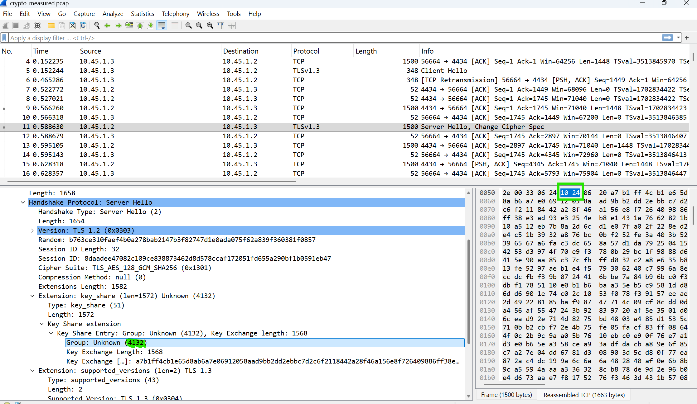
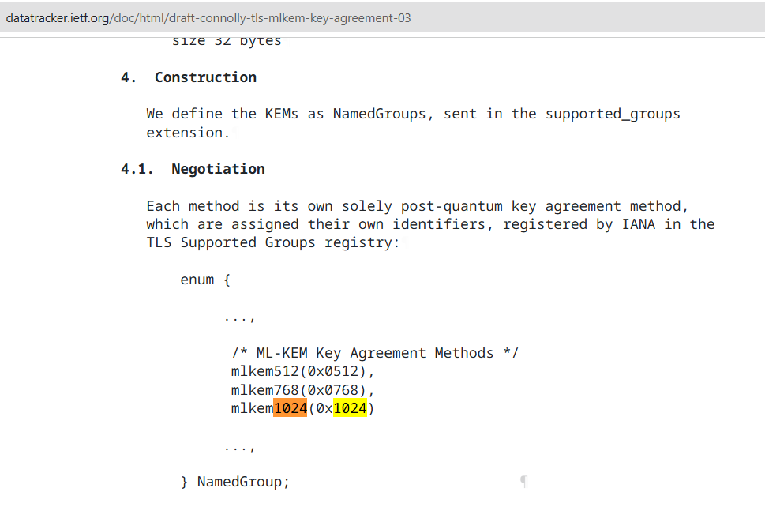

# ERA-Crypto: Policy-Bounded Post-Quantum Crypto-Agility for a 5G/O-RAN Testbed
<--
**Reproducible implementation · Experimental configuration · Packet traces · Analysis and validation**
ERA-Crypto is a context-aware post-quantum cryptography (PQC) selection framework implemented over a software-defined 5G/O-RAN environment. The system selects a TLS 1.3 key-encapsulation mechanism (KEM) using dual-gNB E2/KPM-derived path activity and selects a TLS signature configuration using endpoint battery state. Every selection remains subject to a configured, PQC-only policy envelope.

This repository organizes the deployment scripts, controller and endpoint components, experimental settings, processed measurements, validation records, and selected packet captures needed to examine the implementation and reproduce its available results. It supports two workflows:

- **Offline verification:** reproduce measurements from the included TLS PCAP samples and examine the processed dataset without running a 5G stack.
- **End-to-end execution:** reconstruct the four-machine environment, validate the radio/core/RIC/TLS stack, and run a new blocked campaign with the same recorded design.
- **Implementation · Experimental configuration · Experimental dataset · Packet captures · Reproducibility**
-->

ERA-Crypto implements context-aware **post-quantum cryptography (PQC) selection** for TLS 1.3 in a software-defined 5G/O-RAN testbed. It selects an **ML-KEM key-encapsulation mechanism** from dual-gNB E2/KPM-derived path activity and a **PQC signature configuration** from endpoint battery state. A configured PQC-only policy envelope constrains every selection.

The repository provides implementation scripts, processed results, representative packet captures and validation metadata for offline verification.

> **Artifact scope:** The processed dataset covers **200 accepted runs**. This repository includes **representative raw PCAP samples**, not necessarily the complete set of raw captures for all runs. An independent deployment also requires compatible, locally built software and appropriately sanitized configuration templates.

## 1. Architecture

```text
                         Alienware x16 R2 (Ubuntu / VMware)
         ┌─────────────────────────────────────────────────────────┐
         │ VM1 (gNB1 + Open5GS + near-RT RIC + ERA controller)     │
         │                              │                          │
         │                 dual-gNB E2/KPM observations            │
         │                              │                          │
         │ VM2 (gNB2) ──────────────────┘                          │
         └─────────────────────────────────────────────────────────┘
                           5G user-plane path
  ┌──────────────┐        ┌─────────┐       ┌─────────┐     ┌───────────────┐
  │ UE2: Pi 5    │ ─ZMQ─► │  gNB1   │ ─core─►│  gNB2   │─ZMQ─►│ UE1: Pi 5     │
  │ srsUE        │        └─────────┘       └─────────┘     │ srsUE         │
  │ PQC client   │◄──────────── PQC decision ────────────────│ PQC server    │
  │ ERA agent    │                                          └───────────────┘
  └──────────────┘
         │
         └── controlled endpoint battery state ─► ERA decision controller
```

**Data path.** UE2 (`10.45.1.3`) establishes PQC-enabled TLS connections to UE1 (`10.45.1.2`) through gNB1, Open5GS and gNB2. The gNBs and endpoints use software radio processing with **ZeroMQ-emulated baseband links**; there is no over-the-air RF link in this configuration. The 5G core, UE/gNB stacks, TCP/TLS traffic and E2/KPM collection execute as software services.

**Control path.** A controller uses a configured path-activity signal calculated from two gNB KPM streams and a controlled UE2 battery-state input. UE2's agent retrieves the resulting KEM/signature decision and the TLS client requests that pair. Policy validation and per-connection requested-versus-negotiated checks provide implementation evidence; they are not a substitute for an adversarial telemetry-security assessment.

### 1.1 Components and responsibilities

| Component | Location | Responsibility |
|---|---|---|
| `decision.py`, policy envelope, mode helper | VM1 | Select and enforce allowed KEM/signature combinations |
| Dual-gNB E2/KPM monitor and feed | VM1 / RIC, both gNBs | Supply path-activity observations to controller |
| `era7h_driver.py`, gates, validator, analysis | VM1 | Schedule randomized runs, collect artifacts and validate outcomes |
| OCUDU gNB1 + Open5GS core | VM1 | First radio access leg and 5G user-plane/core routing |
| OCUDU gNB2 | VM2 | Second radio access leg |
| PQC-TLS servers | UE1 | Server endpoints for Falcon-512 and ML-DSA-44 configurations |
| `agent.sh`, battery provider, benchmark worker | UE2 | Obtain decisions, generate TLS connections and collect captures |

### 1.2 Cryptographic decision policy

The evaluated selections are drawn from:

- **KEM:** ML-KEM-768 or ML-KEM-1024.
- **TLS signature configuration:** Falcon-512 or ML-DSA-44.
- **RAN input:** *path-active* versus *path-inactive*, based on an E2/KPM-derived threshold; this is **not** a direct congestion classifier.
- **Battery input:** controlled UE2 state of 90% or 15%; the configured threshold is 30%. This does **not** establish measured battery-life savings.

| Controlled context | UE2 battery | Path activity | Dual-axis selected pair |
|---|---:|---|---|
| `C00` | 90% | Inactive | ML-KEM-1024 + ML-DSA-44 |
| `CB0` | 15% | Inactive | ML-KEM-1024 + Falcon-512 |
| `C0F` | 90% | Active | ML-KEM-768 + ML-DSA-44 |
| `CBF` | 15% | Active | ML-KEM-768 + Falcon-512 |

The path-activity cutoff was configured as **322.4 kbit/s** in the processed KPM signal, and the active-path experiments used an iperf3 UDP offered rate of **0.712 Mbit/s**. The mapping and cutoffs are configured experimental policy choices, not independently optimized responses to congestion. The controller forbids classical-algorithm selection within the specified envelope; that statement does not by itself prove resilience to attacker-controlled telemetry.

## 2. Hardware and network configuration

| Machine | Hardware / virtual allocation | Memory | Role |
|---|---|---|---|
| Alienware host | Alienware x16 R2; Intel Core Ultra 9 185H (16 physical cores, 22 logical CPUs reported by Linux); NVIDIA RTX 4070 Laptop GPU (8,188 MiB VRAM) | ~30 GiB usable host RAM | VMware host |
| VM1 | VMware guest; 8 vCPUs, 8 cores/socket | 16 GiB configured (~15 GiB reported by guest) | gNB1, Open5GS, RIC, controller, experiment driver |
| VM2 | VMware guest; 8 vCPUs, 8 cores/socket | 16 GiB configured (~15 GiB reported by guest) | gNB2 |
| UE1 | Raspberry Pi 5 Model B Rev 1.1; 4 × Arm Cortex-A76 cores | 8-GB class (~7.8 GiB reported) | srsUE and PQC-TLS server |
| UE2 | Raspberry Pi 5, 4 × Arm Cortex-A76 cores (reported same hardware class as UE1) | 8-GB class (reported; independent system dump pending) | srsUE, PQC-TLS client, agent, worker |

Host storage: Samsung PM9F1 1024-GB NVMe (953.9 GiB displayed by Linux). The GPU is listed for system provenance; GPU acceleration for the radio/TLS experiment was **not established**. The two guests each have a 16-GiB allocation; these are configured allocations rather than measurements of simultaneous physical memory usage.

| Node | Historical management address | Experiment interface / relevant ports |
|---|---|---|
| VM1 | `192.168.0.4` | gNB1, controller API on port `8080` |
| VM2 | `192.168.0.5` | gNB2; route toward core through VM1 |
| UE1 | `192.168.0.10` | `10.45.1.2` in UE namespace; PQC server TCP ports `4433` and `4434` |
| UE2 | `192.168.0.20` | `10.45.1.3` in UE namespace; adaptive PQC-TLS client |

These management addresses are **lab-specific examples**. Adapt the network and UE namespace settings for another deployment. The archived VM2 route was `10.53.1.0/24 via 192.168.0.4 dev ens37`; confirm interfaces and subnet routing before applying it.

Both checked gNB YAML files specify **NR band 3, 10 MHz channel bandwidth, 15 kHz subcarrier spacing, 11.52 Msamples/s base sample rate and E2AP enabled**.

## 3. Software environment and provenance

### 3.1 Versions

| Component | Version / identifier | Where observed |
|---|---|---|
| Host OS / kernel | Ubuntu 24.04.4 LTS / `7.0.0-28-generic` | Alienware, Nov. 17 |
| VMware Workstation | 26.0.0, build `25388281` | Alienware, Nov. 17 |
| VM1 and VM2 OS / kernel | Ubuntu 24.04 LTS / `7.0.0-38-generic` | Both guests, Nov. 17 |
| UE1 OS / kernel | Ubuntu 24.04.4 LTS / `6.8.0-1065-raspi` | UE1, Nov. 17 |
| Python | 3.12.3 | VM1, VM2, UE1 |
| GNU Radio | 3.10.9.2 | VM1 |
| Docker / Docker Compose | 29.1.3 / 2.40.3 | VM1 |
| TShark (Wireshark CLI) | 4.2.2 | VM1 |
| tcpdump / libpcap | 4.99.4 / 1.10.4 | VM1, UE1 |
| iperf3 | 3.16 | VM1, VM2, UE1 |
| OCUDU checkout | `c446f5d6ab2fe936ab6d75d04a5f4b12cb692bf7` | VM1 and VM2 |
| gNB executable SHA-256 | `e372a116dd0ad5149d8154ce3ebdbf94b4c677263d126a7145534f8bbb39f9b2` | VM1 and VM2, matching binaries |
| BoringSSL checkout | `0599bb559d3be76a98f0940d494411b6a8e0b18e` | UE1 |
| UE1 BoringSSL `bssl` SHA-256 | `5ae69072636050f8bcdc94cbc5f1efbc10e2775da59e28d1671ed1ce132556b6` | UE1, Nov. 17 |
| liboqs checkout | `d0d0413dc9fff538296ab86bac492cb4bf54dedb` | UE1 |
| srsRAN_4G checkout | `6bcbd9e5bf8686aa7085202cd847c5ddd64a9c16` | UE1 |

The UE1 BoringSSL and liboqs working trees contains local modifications. 

### 3.2 Rebuilding the original crypto environment

A matching PQC stack requires compatible BoringSSL/liboqs source and local changes, the correct enabled algorithms, and server/client build settings. Record:

```bash
# Run on EACH endpoint and retain the output in a private environment inventory.
git -C ~/Downloads/boringssl rev-parse HEAD
git -C ~/Downloads/boringssl status --short
sha256sum ~/Downloads/boringssl/build/tool/bssl

git -C ~/Downloads/liboqs rev-parse HEAD
git -C ~/Downloads/liboqs status --short
git -C ~/srsRAN_4G rev-parse HEAD
```

## 4. Repository layout

```text
ERA-Crypto/
├── analysis/              # Validation and PCAP reanalysis
├── code/
│   ├── ue1/scripts/       # PQC-TLS server and battery control
│   ├── ue2/
│   │   ├── runtime/       # TLS measurement and worker scripts
│   │   └── scripts/       # Adaptation agent and battery controls
│   ├── vm1/
│   │   ├── controller/    # Policy controller and E2/KPM processing
│   │   ├── final_source_pack/
│   │   └── runtime/       # Experiment driver and analysis
│   └── vm2/               # Second gNB components
├── configs/               # Configuration files
├── data/
│   ├── pcap_samples/      # Six representative experimental runs
│   └── processed/         # Processed results and statistics
├── docs/                  # Setup guides and packet screenshots
├── integrity/             # Manifests, hashes and run metadata
└── old/                   # Archived previous repository files
```

The repository includes implementation scripts, processed measurements from 200 accepted experimental runs, and six representative TLS packet-capture samples. The `analysis/` directory provides tools for independent verification, while `integrity/` preserves experimental configuration and validation metadata.


## 5. TLS PCAP walkthrough: ML-KEM-1024 and group ID `0x1024`

The screenshot below is an example of the experiment's TLS 1.3 `ServerHello`.



The captured TLS 1.3 ServerHello contains a key-share group identifier of `4132 (0x1024)` and a 1,568-byte key-exchange value. The identifier corresponds to `mlkem1024(0x1024)` in the historical IETF ML-KEM TLS draft, and the key-exchange length is consistent with an ML-KEM-1024 ciphertext.

This identifier predates the currently assigned ML-KEM-1024 TLS group code point, `0x0202`. 

**References:** [Historical IETF draft](https://datatracker.ietf.org/doc/html/draft-connolly-tls-mlkem-key-agreement-03) · [IANA TLS Supported Groups registry](https://www.iana.org/assignments/tls-parameters/tls-parameters.xhtml#tls-parameters-8)

| Field visible in Wireshark | Meaning |
|---|---|
| `Handshake Type: Server Hello (2)` | A TLS server response |
| `Version: TLS 1.2 (0x0303)` | TLS 1.3 compatibility field, not a TLS 1.2 downgrade |
| `supported_versions: TLS 1.3 (0x0304)` | Negotiated TLS protocol version |
| `key_share → Group: Unknown (4132)` | `4132` decimal = **`0x1024`** hexadecimal |
| `Key Exchange length: 1568` | Matches the **1,568-byte ML-KEM-1024 ciphertext** |



**Why `0x1024`?** The historical IETF Internet-Draft [`draft-connolly-tls-mlkem-key-agreement-03`](https://datatracker.ietf.org/doc/html/draft-connolly-tls-mlkem-key-agreement-03) defined `mlkem1024(0x1024)` as a TLS `NamedGroup`. That draft was replaced; the current [IANA TLS Supported Groups registry](https://www.iana.org/assignments/tls-parameters/tls-parameters.xhtml#tls-parameters-8) assigns **514 (`0x0202`)** to MLKEM1024. The 1,568-byte ciphertext size is defined by [NIST FIPS 203](https://nvlpubs.nist.gov/nistpubs/FIPS/NIST.FIPS.203.pdf). TLS 1.3 ServerHello's legacy version field is defined in [RFC 8446](https://www.rfc-editor.org/rfc/rfc8446.html).

Wireshark displaying *Unknown* means that this decoder did not map code point 4132 to a label; it does **not** by itself indicate failure. The code point and length are strong evidence consistent with historical ML-KEM-1024 negotiation. For implementation-level confirmation, correlate this PCAP with the actual BoringSSL group mapping, the executed binary hash and the matching per-handshake log.

A detailed packet-level verification checklist is in [PCAP evidence](data/pcap_samples).

**Locate the identifier in BoringSSL (UE1 or UE2):**

```bash
cd ~/Downloads/boringssl
grep -RniE '0x1024|4132|mlkem1024|MLKEM1024|SSL_GROUP_MLKEM1024' \
  include/ ssl/ tool/ 2>/dev/null | head -80
sha256sum build/tool/bssl
```

The TLS `NamedGroup` mapping belongs in the TLS integration (BoringSSL or its modifications), while liboqs provides KEM implementations. **Do not infer the negotiated signature from this ServerHello screenshot**: TLS 1.3 authentication messages occur after ServerHello and are encrypted. Use the matched `crypto_log_measured.csv` and the server configuration to establish Falcon-512 versus ML-DSA-44.

To inspect the same fields in an included trace:

```bash
RUN=E2_CBF_era_dual_b01  # substitute an actually included run
PCAP="data/pcap_samples/$RUN/ue2/crypto_measured.pcap"
tshark -r "$PCAP" -Y 'tls.handshake.type == 2' -V | \
  grep -Ei 'Server Hello|supported.version|Group:|Key Exchange Length'
```

## 6. Evaluation scope and documentation

The evaluation characterizes **PQC selection, protocol performance and policy enforcement** under ZeroMQ-based radio emulation, not over-the-air 5G. Controlled battery inputs do not establish energy savings; tested enforcement is not a comprehensive adversarial-security assessment.

For full deployment dependencies and validation, see [Setup and rerun](docs/SETUP_AND_RERUN.md) and, [File map](docs/FILE_MAP.md).

## 7. Integrity checks, expected outputs and limitations

### 7.1 Verify file integrity

From the repository root, if `integrity/CANDIDATE_SHA256.txt` is present:

```bash
sha256sum -c integrity/CANDIDATE_SHA256.txt
```

This manifest covers the reviewed GitHub candidate files and must be regenerated whenever files are edited. The original `valid200_SHA256_final.txt` records the full accepted dataset in its original source layout; a public sample-only repository **cannot** validate all of those original raw-file entries.

### 7.2 Recorded experiment scale and analysis units

| Item | Recorded count |
|---|---:|
| Controlled contexts | 4 |
| Policy modes | 5 |
| Randomized blocks | 10 |
| Accepted independent runs | **200** |
| TLS warm-up connections | **1,000** |
| TLS measured connections | **8,000** |
| Accepted runs with both gNB KPM sources | **200/200** |
| Accepted runs passing saved validator | **200/200** |

The **independent unit** for comparisons is the run (10 runs per context/policy cell), not each individual handshake. The processed summaries, paired comparisons and confidence intervals must be interpreted at run level.

### 7.3 Evaluation Scope

ERA-Crypto is evaluated in a software-defined 5G/O-RAN testbed with ZeroMQ-based radio transport. The experimental results characterize cryptographic adaptation and protocol performance within this environment.

The evaluation uses controlled endpoint battery states and RAN path-activity conditions to examine independent and combined KEM/signature adaptation. The policy thresholds are configured parameters, and the experiments focus on cryptographic selection rather than energy consumption or congestion estimation.

All cryptographic selections are checked against a configured PQC-only policy envelope. The enforcement evaluation examines rejection of disallowed algorithm choices under the tested conditions.

The repository provides processed results, analysis code, validation metadata, and representative packet captures for independent verification. Full experimental deployment requires the documented software stack, network configuration, and compatible cryptographic builds.
<!--
### 8.3 Interpretation boundaries

- **Software-emulated radio:** measurements characterize a ZeroMQ/software-radio testbed; absolute latency and throughput are not over-the-air 5G performance figures.
- **Path activity versus congestion:** deliberate offered UDP traffic changes observed path activity, but the controller input is not a congestion estimate or an optimized adaptive threshold.
- **Endpoint state:** 90%/15% battery contexts are controlled; the protocol tests alone do not measure energy savings.
- **Security scope:** the configured PQC-only allowlist restricts selected algorithms, but that is not evidence of complete downgrade resistance under malicious or stale telemetry.
- **Raw data availability:** public sample captures support independent packet-level inspection; re-estimating all 200 raw captures requires a separately preserved complete dataset.
- **Rebuild scope:** source commit hashes without local integration patches and matching binaries do not establish binary reproducibility.
- **Capture sensitivity:** review PCAP payloads, certificate material, timestamps, local addresses and identifying metadata before any public release.


## 8. Reproducibility status and references

Before calling a new release reproducible, verify that:

1. The included `campaign_config.json` and `schedule.csv` agree with the dataset counts and run names.
2. `analysis/reanalyze_samples.sh` passes on **every released sample**, and those samples appear in `integrity/sample_manifest.tsv`.
3. The frozen hashes identify the actual deployed controller, worker scripts and `bssl` binaries; locally modified crypto source is documented with reviewed patches or explicitly listed as a limitation.
4. Each public configuration is a sanitized, functional template; real subscriber credentials, SSH material and TLS private keys stay outside the repository.
5. The screenshot is associated with an exact PCAP/packet number **or** clearly labeled as an illustrative snapshot.
6. All Git-tracked files and history, including PCAPs, have been reviewed for sensitive content and file size.
-->
**Standards and protocol references**

- [NIST FIPS 203 - ML-KEM](https://nvlpubs.nist.gov/nistpubs/FIPS/NIST.FIPS.203.pdf)
- [Historical IETF draft: ML-KEM TLS `NamedGroup` values (`0x1024`)](https://datatracker.ietf.org/doc/html/draft-connolly-tls-mlkem-key-agreement-03)
- [IANA TLS Supported Groups registry (`MLKEM1024` = 514)](https://www.iana.org/assignments/tls-parameters/tls-parameters.xhtml#tls-parameters-8)
- [RFC 8446 - TLS 1.3](https://www.rfc-editor.org/rfc/rfc8446.html)

**Reproducibility summary:** the repository is designed to make the experiment architecture, recorded environment and offline sample-PCAP measurement workflow inspectable and repeatable. A full clean-room four-machine rerun remains dependent on compatible builds, sanitized deployment configuration and preserved experiment metadata; it should be described as independently reproduced only after those checks have actually succeeded.
